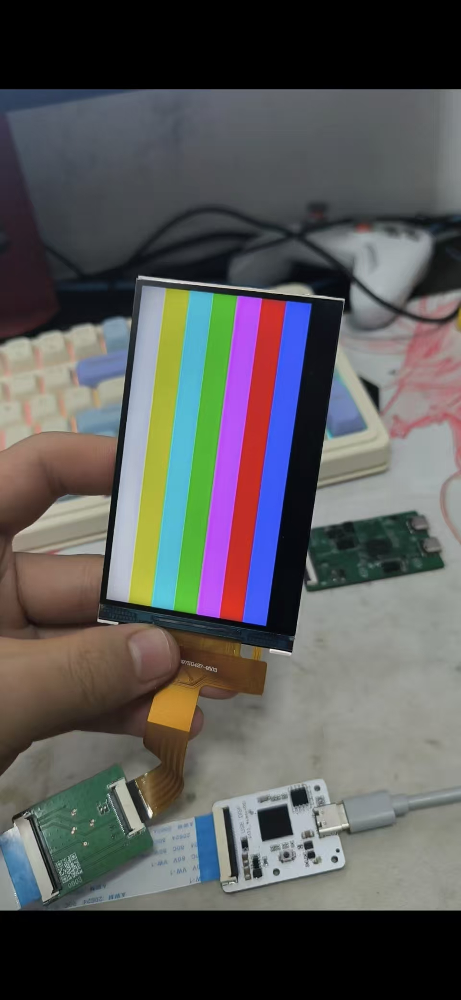
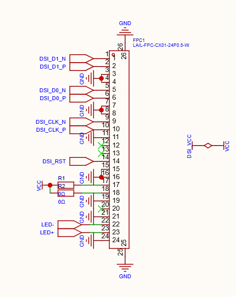

# FX397IIG427 / GC9503CV MIPI-DSI 屏幕资料

本仓库整理了一块 `FX397IIG427` 模组的屏幕参数、`GC9503CV` 初始化序列、FPC 接口资料和点亮验证照片。

> 资料来源：从 `bsp/artinchip/drv/display/panel/panel_dsi_gc9503cv_397_b.c` 提取并整理。本文只描述屏幕本身，不包含具体平台的 GPIO、电源、复位脚或 DSI 主控配置。

## 点亮验证




## 屏幕参数

| 项目 | 参数 |
| --- | --- |
| 屏幕 / 驱动 IC | FX397IIG427 / GC9503CV |
| 分辨率 | 480 × 800，纵向 |
| 接口 | MIPI-DSI，Video Burst 模式 |
| DSI 数据通道 | 2 lane |
| 像素格式 | RGB888（DCS `0x3A = 0x77`） |
| 虚拟通道 | 0 |
| 像素时钟 | 26 MHz |
| 水平时序 | 前廊 20，后廊 20，同步宽度 5，有效区 480 |
| 垂直时序 | 前廊 10，后廊 10，同步宽度 5，有效区 800 |
| 理论帧率 | 约 59.98 Hz，计算式：`26 MHz / (525 × 825)` |

## FPC 接口




## 初始化序列

以下序列来自驱动源码，按发送顺序列出：

```text
F0 55 AA 52 08 00
F6 5A 87
C1 3F
C2 0E
C6 F8
C9 10
CD 25
86 99 A3 A3 51
87 04 03 66
AC 45
F8 8A
A7 47
A0 88
FA 08 08 00 04
71 48
72 48
73 00 44
A3 6E
FD 28 3C 00
97 EE
83 93
9A 4B
9B 4B
82 20 20
B1 10
7A 0F 13
7B 0F 13
6D 1E 1E 04 02 0D 1E 12 11 14 13 05 06 1D 1E 1E 1E 1E 1E 1D 06 05 0B 0C 09 0A 1E 0D 01 03 1E 1E
64 38 08 03 C0 03 03 38 06 03 C2 03 03 20 6D 20 6D
65 38 04 03 C4 03 03 38 02 03 C6 03 03 20 6D 20 6D
66 83 CF 03 C8 03 03 83 D3 03 D2 03 03 20 6D 20 6D
60 38 0C 20 6D 38 0B 20 6D
61 38 0A 20 6D 38 09 20 6D
62 38 25 20 6D 63 C9 20 6D
69 14 22 14 22 44 22 08
D1 00 00 00 24 00 5A 00 7E 00 9D 00 CA 00 EF 01 2A 01 5E 01 AD 01 EE 02 55 02 A2 02 A5 02 EA 03 40 03 70 03 A4 03 B8 03 CA 03 D9 03 EA 03 EF 03 FA 03 FE 03 FF
D2 00 00 00 24 00 5A 00 7E 00 9D 00 CA 00 EF 01 2A 01 5E 01 AD 01 EE 02 55 02 A2 02 A5 02 EA 03 40 03 70 03 A4 03 B8 03 CA 03 D9 03 EA 03 EF 03 FA 03 FE 03 FF
D3 00 00 00 24 00 5A 00 7E 00 9D 00 CA 00 EF 01 2A 01 5E 01 AD 01 EE 02 55 02 A2 02 A5 02 EA 03 40 03 70 03 A4 03 B8 03 CA 03 D9 03 EA 03 EF 03 FA 03 FE 03 FF
D4 00 00 00 24 00 5A 00 7E 00 9D 00 CA 00 EF 01 2A 01 5E 01 AD 01 EE 02 55 02 A2 02 A5 02 EA 03 40 03 70 03 A4 03 B8 03 CA 03 D9 03 EA 03 EF 03 FA 03 FE 03 FF
D5 00 00 00 24 00 5A 00 7E 00 9D 00 CA 00 EF 01 2A 01 5E 01 AD 01 EE 02 55 02 A2 02 A5 02 EA 03 40 03 70 03 A4 03 B8 03 CA 03 D9 03 EA 03 EF 03 FA 03 FE 03 FF
D6 00 00 00 24 00 5A 00 7E 00 9D 00 CA 00 EF 01 2A 01 5E 01 AD 01 EE 02 55 02 A2 02 A5 02 EA 03 40 03 70 03 A4 03 B8 03 CA 03 D9 03 EA 03 EF 03 FA 03 FE 03 FF
3A 77
11
等待 120 ms
29
```

### 时序要求

- `0x11`（Sleep Out）发送后必须等待至少 120 ms，再发送 `0x29`（Display ON）。
- 源码中的读回寄存器操作属于调试功能，不是初始化序列。
- `0x80` 未写入，因为该寄存器与模组 OTP 状态相关；`0x98`/`0x99` 也仅在数据手册默认配置下写入。


